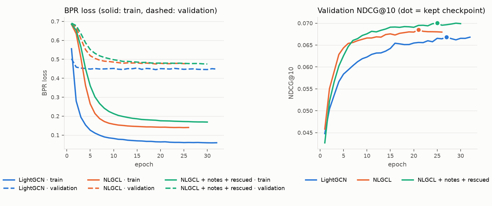
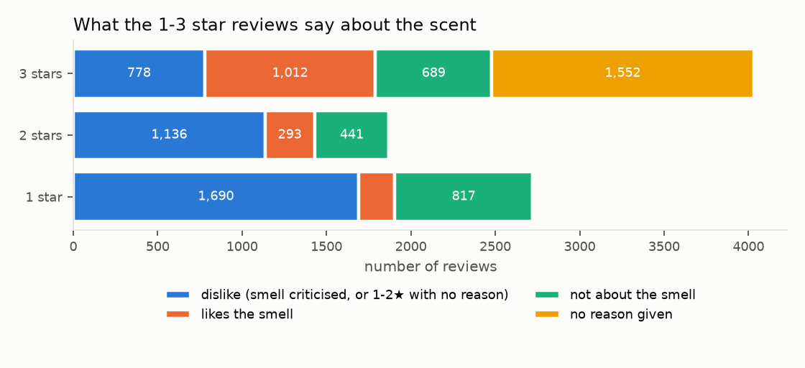
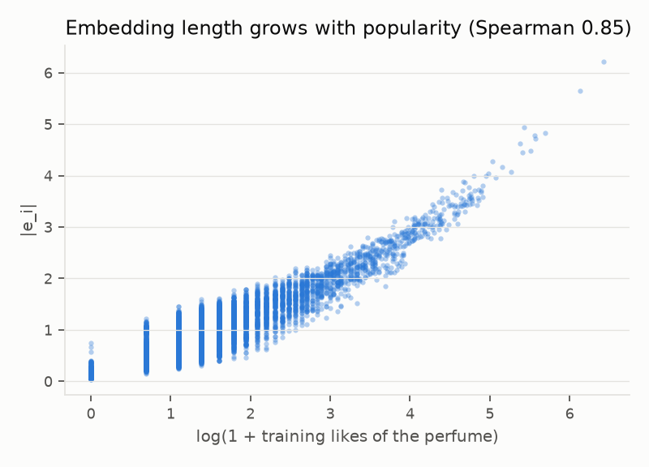
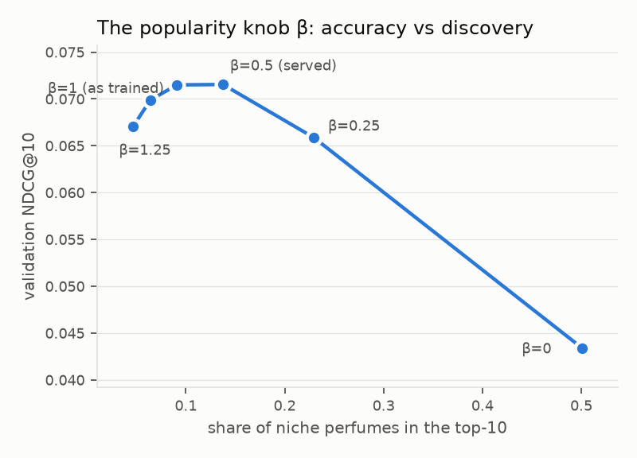

# ScentMatch — Week 3 results and evidence

Status on 18 Nov 2026. Every number below is produced by a script in this repository; the file it comes from is given next to it. The test split was read once, by `scentmatch.eval.final_report`, after every setting had been frozen on validation.

## What changed since Week 2 (and why)

| Professor's feedback | What we did |
|---|---|
| Dropping the Amazon ratings biases everything | No Amazon star rating or review count is used to rank or shown. The 1-3 star reviews are no longer thrown away: their text is read and sorted into *dislikes the smell* / *likes the smell* / *not about the smell* (§2). |
| Understand how the model scores and ranks | The NLGCL score is a dot product, and the length of a perfume's vector encodes its popularity (Spearman 0.85). We expose this as one knob, β, and measure personalisation, long-tail share, user segments and cold perfumes (§4). |
| Liking / not liking on the site must give similar / different recommendations | Every ♡ / ✕ is stored in SQLite and the selection is recomputed at once from the whole visit (quiz + likes + rejections). One like raises the NDCG@10 of brand-new visitors from 0.052 to 0.085 (§5). |
| Everything explainable, a real recommendation, something innovative | The served score is a sum of visible parts (notes, NLGCL taste, rejections); "Why this perfume?" shows each part. Innovation: user–perfume–**note** graph, review text as explicit feedback, quiz → notes → graph (§3, §5). |

## 1. Q1 — Does training converge?

`logs/runs/final_*_s3.csv`, `reports/week3_analysis.json`. All three models converge. Validation BPR falls from 0.69 to 0.48 and flattens; train BPR keeps falling (0.14–0.17 for NLGCL), so we stop on validation NDCG@10 (patience 5) and keep the best epoch (21–25). Raising L2 from 1e-4 to 0.1 cut the Week 2 train/validation gap (0.09 vs 0.53) and raised validation NDCG@10 by 12%.

## 2. Low ratings are read, not dropped

`scentmatch.data.reviews` streams the 11 GB review file and keeps the 106,372 reviews of our users on our perfumes. `scentmatch.data.feedback` applies readable keyword rules (with negation handling) to the 8,622 reviews with 1-3 stars:

| | 1 star | 2 stars | 3 stars | total |
|---|---|---|---|---|
| dislikes the smell (or 1-2 stars, no reason) | 1,690 | 1,136 | 778 | 3,604 |
| **likes the smell** (complains about longevity, price…) | 214 | 293 | 1,012 | **1,519** |
| not about the smell (delivery, fake, longevity only) | 817 | 441 | 689 | 1,947 |
| no reason given (3 stars) → ignored | – | – | 1,552 | 1,552 |

Hand check on 80 reviews never seen while writing the rules (`reports/audits/review_label_audit.csv`): 85% of "dislike" and 90% of "like" labels are right; errors among ignored reviews are lost signal, not wrong signal. Only reviews written before the user's validation interaction may be used for training (`period = train`).

Note extraction was audited too (`reports/audits/note_extraction_audit.csv`): 285 of 288 extracted notes are correct (99.0%) after fixing plurals ("orange blossoms"), "leaves", and non-scent uses ("rose gold", "amber glass", "coconut oil").

## 3. Q2 — Final results on the test split (mean ± std over 3 seeds)

`reports/week3_final_tables.md` (all columns), `reports/week3_final_results.json`.

| Ranker | NDCG@10 | Recall@20 | Coverage@10 | AvgPop@10 | Personalisation@10 |
|---|---|---|---|---|---|
| Random | 0.0007 | 0.0030 | 100% | 8 | 0.999 |
| Most-popular | 0.0421 | 0.1046 | 0.3% | 296 | 0.065 |
| Notes only (content, no learning) | 0.0173 | 0.0346 | 68% | 20 | 0.995 |
| LightGCN (NLGCL without contrastive loss) | 0.0637 ± 0.0001 | 0.1587 ± 0.0008 | 47% | 129 | 0.950 |
| NLGCL | 0.0649 ± 0.0003 | 0.1625 ± 0.0004 | 46% | 139 | 0.941 |
| NLGCL + note nodes | 0.0660 ± 0.0003 | 0.1632 ± 0.0002 | 39% | 140 | 0.941 |
| **NLGCL + note nodes + liked low-star reviews** | **0.0662 ± 0.0004** | **0.1649 ± 0.0007** | 39% | 141 | 0.939 |
| same, β = 0.5 (served for known users) | 0.0645 ± 0.0006 | 0.1568 ± 0.0010 | **65%** | **99** | **0.974** |

Reading:
- The best model beats most-popular by **+57%** NDCG@10. Every step is consistent across seeds and with validation: NLGCL > LightGCN (+1.9%, the paper's contrastive idea helps a little), note nodes +1.7%, liked low-star reviews +0.3% on test (+1.0% on validation).
- In Week 2 note nodes *hurt* (−10%). Two fixes: distinct notes inside a batch (repeated notes were false negatives in InfoNCE) and a lighter perfume–note edge weight (0.3).
- β = 0.5 was chosen on validation, where it is *better* than β = 1 (0.0716 vs 0.0695). On test it costs 2.6% NDCG but covers 65% of the catalogue instead of 39% and halves the average popularity of what is shown. We did not re-tune on test; we keep it as a product choice and report both.
- Segments (test, served family): NDCG@10 is 0.063 for users with 1 training perfume and 0.071–0.074 for 2–5. Cold perfumes (no training like): every graph model scores 0 Recall@20; only the notes-only ranker finds some (3.9%) — a limit we state.

## 4. How the model ranks — popularity is inside the embeddings

 

`scentmatch.eval.analysis`. Score = ⟨e_u, e_i⟩ = |e_u|·|e_i|·cos. The length |e_i| grows with the perfume's number of likes (Spearman 0.85), so the dot product pushes popular perfumes to everybody. Ranking by cos(e_u, e_i)·|e_i|^β makes this explicit (validation):

| β | 0 (pure taste) | 0.25 | **0.5** | 0.75 | 1 (as trained) | 1.25 |
|---|---|---|---|---|---|---|
| NDCG@10 | 0.043 | 0.066 | **0.0715** | 0.0715 | 0.070 | 0.067 |
| Coverage@10 | 99% | 86% | **65%** | 50% | 39% | 32% |
| niche share of top-10 | 50% | 23% | **14%** | 9% | 6% | 5% |

## 5. Innovation — brand-new visitors, likes and rejections

**Served score** (`scentmatch.train.predict.Scorer`, identical online and offline):
`score = w_notes · NOTES + (1 − w_notes) · TASTE − w_avoid · AVOID`, where NOTES is an IDF-weighted note match with the quiz notes and the notes of liked perfumes, TASTE is the NLGCL cosine with a taste vector that is a *sum* of anchors (each liked perfume, or the best note matches for a quiz-only visitor) times |e_i|^β, and AVOID is closeness to rejected perfumes and their notes. Because TASTE is a sum, "close to Yara, which you loved" is an exact part of the score. The parts add up to the score shown (tested).

**Cold-start test** (`scentmatch.eval.coldstart_eval`, `reports/week3_coldstart.json`): 2,000 users removed from training; the notes of their first liked perfume stand in for the quiz; we predict their other perfumes. Weights tuned on 983 users, reported on the other 1,017:

| New visitor | NDCG@10 | Recall@20 | Coverage@10 |
|---|---|---|---|
| Most-popular | 0.054 | 0.099 | 0.2% |
| Quiz → notes only | 0.018 | 0.028 | 52% |
| Quiz → mean of learned note embeddings (Week 1 plan) | 0.047 | 0.089 | 6% |
| Quiz → ScentMatch (user–perfume model) | 0.047 | 0.082 | 24% |
| **Quiz → ScentMatch (note model)** | **0.052** | **0.090** | **23%** |
| Quiz + 1 like → ScentMatch (user–perfume model) | 0.079 | 0.144 | 27% |
| **Quiz + 1 like → ScentMatch (note model)** | **0.085 (+58% vs popular)** | **0.152** | **28%** |

The quiz alone matches most-popular accuracy while covering 100× more of the catalogue; one like makes it 58% better than most-popular. The note graph helps exactly where it was meant to: new users.

**"Not for me"** (`scentmatch.eval.feedback_eval`): on the 1,553 users who disliked a perfume in a review, the AVOID weight was set on validation to the strongest penalty costing ≤ 5% NDCG (w_avoid = 0.1). On test: NDCG −2%, closeness of the top-10 to the rejected perfume −8%. It does not predict *future* dislikes (0.518 with or without). Using dislikes as hard negatives during training did not help either (`reports/sweeps/feedback.csv`). Honest conclusion: a rejection is useful to steer the current session, not to predict the next rejection.

## 6. Q3 — No leakage

`tests/test_leakage.py` (9 tests on the real data): disjoint splits; chronological per user; graph built from training edges only (checked edge by edge); popularity from training only; harness masks train items for validation and train+validation for test; training never reads the test file (`EvalData.load(with_test=False)`); explicit feedback used for training predates the user's validation interaction; cold-start users absent from the cold training file. The test caught a real bug (90 pairs that were a low-star review and a positive at the same time), now fixed. Two stated limits: serving excludes all rated perfumes (train+val+test) by design, and leave-last-out is per user, not a global time cut.

## 7. Q5 — Live system

`reports/latency.json` (100 requests each, laptop CPU): known user 3.5 ms mean / 4.8 ms max; quiz 3.8 / 4.6; session (quiz + like read from SQLite) 3.9 / 4.9; similar 3.5 / 4.4; log 1.5 / 2.7. `reports/db_proof.txt`: like count 12 → 13 after `POST /log_interaction`, row shown. Screenshots: `reports/screenshots/01`–`07` (quiz, results, after a like, "Why this perfume?", after "Not for me", known user, "Your collection" with undo / switch).

Added on 20 Nov 2026: every reaction can be taken back (`undo` event, append-only log, latest event wins) or switched, from the selection or from the "Your collection" tab; `GET /session/{user_id}` returns the current quiz and choices. Re-measured with this change (100 calls, a visitor with a quiz and two reactions): session 5.5 ms mean / 20 ms max, `GET /session` 1.1 / 1.5 ms. Tests: `test_undo_and_switch_a_reaction`, `test_old_database_is_migrated`.

## 8. Q6 — Reproducibility

`scripts/make_release.sh` builds `dist/scentmatch-data.tar.gz` (31 MB: processed data, empty SQLite catalogue, served model) + `SHA256SUMS`; `scripts/fetch_release.sh` downloads and verifies it; README quick start is 3 commands. Clean-folder rehearsal (fresh copy of the committed files, new virtualenv): install 30 s, data 1 s, 34 tests pass, API serves the model (re-run on 20 Nov 2026 with the rebuilt release, after adding undo/switch of reactions). The real test by a member who did not write the code is still to do once the release is published.

## Hyper-parameter search (validation only)

`reports/sweeps/*.csv`. Contrastive weight λ₁ ≥ 2·10⁻⁴ stops learning (the summed InfoNCE term dominates BPR); best λ₁ = 10⁻⁵ with L2 = 0.1 and 2 layers. LightGCN best: 3 layers, L2 = 0.03. Notes: edge weight 0.3, λ_note = 10⁻⁵. Hard negatives from dislikes (p = 0.3, 0.6): lower NDCG, no gain on dislikes → off. Liked low-star reviews as extra positives: on.
